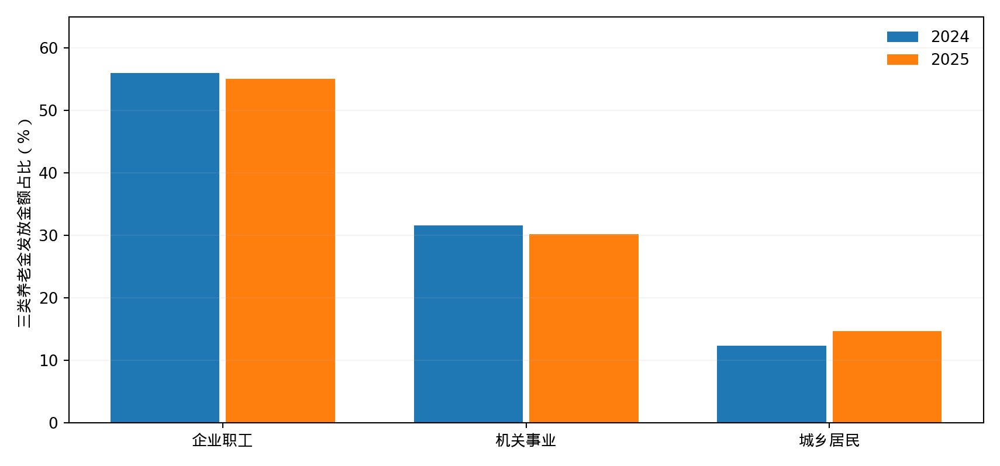
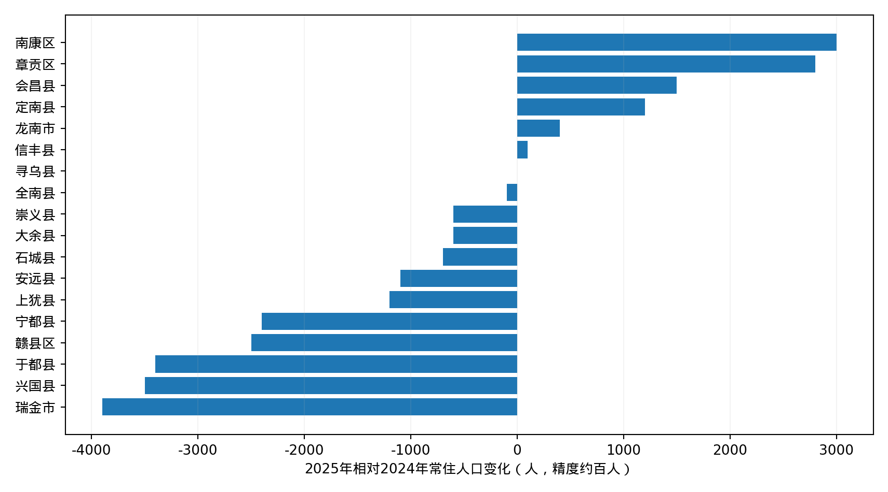

# 江西省县域社会结构与社会保障实证研究

**Jiangxi County Social Structure & Social Protection Research (2025 baseline)**

> 状态：第一阶段研究成果；**非最终100县完整调查，也非政策因果评估**。研究基准年2025，对照2024；逐步扩展2020—2025。覆盖江西11个设区市、100个县级行政区的研究框架。

## 研究目标

基于可追溯的政府统计公报、财政及社会保险基金预算决算、人社资料和住房公积金年报，研究人口变迁、就业分层、退休养老、住房公积金和制度分配之间的关系。重点区分**观察到的事实、结构分解、机制假说和因果识别**，不预设政治或分配结论。

## 首批发现（有条件成立）

| 发现 | 数值/结果 | 证据与局限 |
|---|---|---|
| 峡江2025机关事业单位养老金份额 | 金额30.202%，年末领取人数6.095% | 署名统计公报转载（B级），待县政府原件复核；三类养老待遇口径 |
| 峡江2024→2025三类养老金年度发放金额 | 48,140.38 → 53,700.58万元 | 年末领取人数并非全年平均领取人月，分解不代表因果影响 |
| 赣州18个行政县区2024→2025人口变化 | 11减、6增、1持平 | 政府统计表；不能直接视为全部迁出 |
| 赣州18县城镇化率变化 | 18个全部提高 | 城镇化率提高不代表总人口必然增长 |

**禁止误读**：不能把两个县的机关事业单位养老金金额占比推广到全省；不能用社会保险基金支出减去一般公共预算“社会保障和就业”支出来计算基金赤字；不能把市级公积金数据分摊到县级假充实测。

## 研究问题

1. **RQ1 养老差距**：企业职工、机关事业单位和城乡居民基本养老保险的领取人数、金额、人均待遇及差距如何分布？
2. **RQ2 人口变迁**：迁移、老龄化和县域缴费—退休人口结构有什么关系？
3. **RQ3 劳动市场**：正式就业、灵活就业、工资和住房公积金覆盖具有怎样的关联？
4. **RQ4 公共财政**：基金、财政补助、统筹及历史制度规则如何作用？
5. **RQ5 社会分层**：职业、代际、城乡差距是否体现累积性的保障机会差异？

## 使用说明

- `docs/`：研究设计、口径、质量报告、发现与局限
- `data/`：官方行政区名录、分县观察与来源索引（区分不同证据等级）
- `scripts/`：数据处理、复现及测试
- `reports/`：阶段性报告（不可替代同行评审）
- `outputs/`：可发布图表和衍生数据

优先阅读 `docs/evidence-policy.md` 和 `docs/data-gaps.md`。若缺少原始来源截图或文件SHA-256，应明确标注，不能将人工转录的CSV称作官方原始数据文件。

## 质量门槛

- 所有进入核心结论的数字必须有可定位的来源和计算方法；
- 单位、年份、行政层级、统计分母不可混淆；缺失值不得用0替代；
- 核心公式必须独立复算并测试金额占比求和、两年差分和结构分解恒等式；
- 现有完整三类养老金金额样本仅2/100县，人数同时齐全仅1/100县，不据此估计江西全省份额。

## 研究版本

- **v0.1（2026-10-27）** 第一阶段工作资料、方法规范、验证过的案例计算及待核问题。
- 本仓库为公开研究材料；后续以可复核证据持续迭代。资料版权归各原发布机构，尽量引用原始链接，不擅自将政府原始资料归属本仓库。

## 引用

引用任何具体数值前，请核对对应 `data/sources.csv`（或来源文档）的URL、年份、证据等级，并在引用中披露分母和口径限制。

## 项目边界

本研究不处理可识别个人的社保账户、家庭金融数据，也不使用未经授权的敏感微观资料。

## 阶段性成果下载（v0.1）

- [2025可复现审计工作簿（11表，优先复核版本）](outputs/江西县域社会保障_2025可复现审计工作簿.xlsx)
- [原始来源封存与独立复核增补](reports/2025_source_audit_and_review.md)
- [逐条来源数字审计（142条）](outputs/source_number_audit.csv)
- [原始网页快照与SHA-256清单](data/source_snapshot_manifest.csv)
- [更新后的阶段研究报告 PDF](outputs/江西省县域社会分层与社会保障制度_2025实证研究报告.pdf)
- [更新后的阶段研究报告 Markdown](outputs/江西省县域社会结构与社会保障制度实证研究_报告.md)
- [2025严格核验版研究Excel（31表）](outputs/江西省县域社会保障实证研究_2025严格核验版.xlsx)
- [实证研究报告 PDF](reports/2025_stage1_empirical_report.pdf)
- [实证研究报告 Markdown](reports/2025_stage1_empirical_report.md)
- [观察数据 CSV：142条（A101、B40、计算估算C1）](data/observations_reviewed.csv)
- [原始资料来源表：16项](data/sources.csv)
- [江西100县区名录](data/regions_2025.csv)
- [赣州18县2024—2025人口比较](outputs/ganzhou_population_2024_2025.csv)
- [既有阶段基线工作簿（未经全部终核）](data/上一版基础数据库.xlsx)

复现：`python -S scripts/prepare_data.py && python -S scripts/reproduce.py && python -S scripts/test_research.py`。其中 `prepare_data.py` 现在只检查已提交的CSV（不会重写原始记录）。新审计工作簿还需 `pip install requests beautifulsoup4 openpyxl`，随后运行 `python scripts/archive_sources.py && python scripts/audit_snapshots.py && python scripts/build_audited_workbook.py`。网页会变动，已归档快照与哈希用于固定本次证据版本。旧31表Excel仍依赖非通用 `artifact_tool`，作为阶段档案保留。

详见 [研究路线与验收](docs/roadmap.md)、[证据政策](docs/evidence-policy.md)、[核验缺口](docs/data-gaps.md)。

## v0.2（进行中）：证据自动核验与县域城乡人口分析

- [赣州18县2024—2025城乡常住人口结构重建](reports/2025_ganzhou_urban_rural.md)：18县合计人口-1.10万、估算城镇人口+11.36万、乡村人口-12.46万；不代表迁移规模。
- `scripts/analyze_urban_rural.py`：纯标准库推算人口、县级误差界并导出CSV/JSON；`scripts/test_urban_rural.py`独立验证恒等式。
- `scripts/archive_sources.py`：新抓取证据按SHA-256不可变保存，失败刷新不覆盖旧快照。
- CI新增`evidence-audit`作业，在固定网页快照上离线执行逐条审计与Excel重建；`validate`作业检查人口衍生指标及档案不可变性。

## 2025县级养老金补证与政策制度研究（第二批）

- [县级基金原始证据、城乡居民基础养老金政策与冲突分析](reports/2025_county_fund_and_resident_pension_policy_evidence.md)
- [2025县级社保基金执行数据：3县+1地级市](data/county_social_fund_execution_2025.csv)：16个严格区分**基金收入/支出**及县/市层级的数值；不冒充养老金发放额。
- [2025基础养老金政策事件台账](data/resident_base_pension_policy_2025.csv)：赣州全市最低205/225、石城县地方+3、浮梁回溯及信丰/安远旧网页冲突；政策发布日期≠政策生效日期。
- `scripts/build_resident_policy_coverage.py`：生成100县×两半年=200行政策覆盖矩阵，只确认赣州城市最低标准和石城正式县级加发；其余县级实际待遇保持缺失。
- `scripts/review_semantic_evidence.py`：对65条历史“仅数字命中”添加指标词和制度归属上下文候选；**全部待人工复核，不自动签核**。
- `scripts/build_audited_workbook.py`：在11表原工作簿上增加基金、政策、覆盖和证据候选等工作表；完整新版工作簿可从最新GitHub Actions的`source-evidence-audit` Artifact下载。
- CI新增对应测试，确保基金与待遇不混账、县级未知标准不被填充、弱证据不被升格为人工验证。
